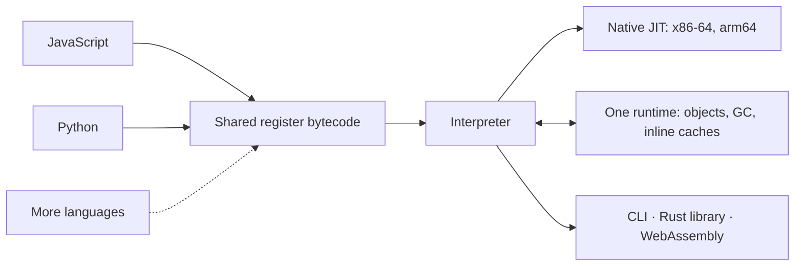

<p align="center">
  
</p>

<h1 align="center">ZIPP</h1>

<p align="center">
  <strong>Zippy Interpreter for Polyglot Programming</strong><br>
  A portable polyglot runtime: one fast virtual machine for many languages, starting with JavaScript and Python.
</p>

<p align="center">
  <a href="https://www.zipp.org/">Website</a> ·
  <a href="https://www.zipp.org/playground/">Playground</a> ·
  <a href="#get-zipp">Download</a> ·
  <a href="#embed-it-in-a-web-page-or-nodejs">Embed</a> ·
  <a href="docs/README.md">Docs</a> ·
  <a href="https://www.zipp.org/journal/">Journal</a>
</p>

---

**ZIPP compiles every language it supports into one shared bytecode and runs it
on one virtual machine, written in Rust.** A JavaScript library and a Python
script run on the same engine, with the same sandbox, the same limits and the
same embedding API, wherever that engine goes: a native command line on
Windows and Linux, a Rust library, or WebAssembly in browsers, Node.js, Deno
and Bun.

**Languages today: JavaScript and Python.**

- **JavaScript** is complete and modern: ES2025, passing **99.999% of test262**: 96,229 / 96,230 executions of the official conformance suite,
  unmodified.
- **Python** is an experimental subset, compiled straight to ZIPP bytecode (no
  CPython inside), with a bundled `torch` subset for tensors, autograd and
  training. Its 196-program test corpus prints exactly what CPython 3.13 prints.

The virtual machine is built to take more languages: each one is a frontend
that compiles to the shared bytecode and inherits everything below it
([how a language plugs in](docs/LANGUAGES.md)).

## Why ZIPP

| | |
| --- | --- |
| **One VM, many languages** | JavaScript and Python share one runtime, one object model and one garbage collector. Write the part that suits each language in that language. |
| **Fast** | A register VM with inline caches and, on x86-64, a native JIT. In its 0.0.28 capture ZIPP runs the 30 benchmark rows in 0.65× Node's time (the 13 everyday rows in 0.55×), starts in **7.5 ms** median process launch, and as a pure interpreter takes 0.68× the time of Bellard's QuickJS. [Performance](docs/PERFORMANCE.md) |
| **Correct** | 99.999% of the pinned test262 corpus, unmodified; the one failure is a documented upstream expectation. [Correctness](docs/CORRECTNESS.md) |
| **Sandboxed by default** | Embedded programs reach nothing you have not allowed: no storage, files, network or host functions until you grant each one, with step and time limits. |
| **Portable** | Windows (x86-64), Linux (x86-64, arm64, armv7), and WebAssembly for every browser and server runtime. One `.wasm` file per engine. |

## Get ZIPP

Every [release](https://github.com/f2i-com/zipp.org/releases) publishes plain
files, checksummed in its `SHA256SUMS`:

| File | What it is |
| --- | --- |
| `zipp-0.0.29-windows-x86_64-portable.exe` | Windows command line. Run it from anywhere. |
| `zipp-0.0.29-windows-x86_64-installer.msi` | The same, installed for your user and added to `PATH` (no administrator rights needed). |
| `zipp-0.0.29-linux-x86_64`, `-linux-arm64`, `-linux-armv7` | Linux command line for x86-64, 64-bit Arm and 32-bit Arm (hard float), built against glibc 2.35. |
| `zipp-0.0.29-javascript.wasm` | The JavaScript engine for browsers and server runtimes. |
| `zipp-0.0.29-javascript-lite.wasm` | The same without `Intl` and `Temporal`, built for size. |
| `zipp-0.0.29-javascript-python.wasm` | JavaScript and Python, with torch built in. |
| `zipp-0.0.29-javascript-python-base.wasm` + `zipp-0.0.29-torch-package.wasm` | JavaScript and Python, with torch as a separate add-on. |
| `zipp-0.0.29-<engine>.wasm.br` | Each of those `.wasm` files compressed with Brotli: about a quarter of the size. Serve it with `Content-Encoding: br` (the browser decodes it); the plain `.wasm` is the default. |
| `zipp-0.0.29-wasm-embed-kit.zip` | `zipp.mjs`, the one file that loads and sandboxes any of the `.wasm` engines, with types, examples and docs. |

**Windows** (PowerShell):

```powershell
$version = '0.0.29'
Invoke-WebRequest "https://github.com/f2i-com/zipp.org/releases/download/v$version/zipp-$version-windows-x86_64-portable.exe" -OutFile zipp.exe
.\zipp.exe js .\app.js
```

Or download and open `zipp-0.0.29-windows-x86_64-installer.msi`, then use
`zipp` in a new terminal.

**Linux**:

```sh
version=0.0.29
arch=x86_64   # or arm64, armv7
curl -fL -o zipp "https://github.com/f2i-com/zipp.org/releases/download/v$version/zipp-$version-linux-$arch"
chmod +x zipp
./zipp js app.js
```

## Run programs

```sh
zipp js app.js        # a JavaScript script
zipp mjs app.mjs      # a JavaScript module (import/export, top-level await)
zipp py main.py       # a Python program (experimental), with the files beside it as its project
zipp --help
```

The native command line uses its JIT on x86-64 and runs the program as
trusted code. To run code you do not trust natively, build the separate
hardened runner, [`zipp-sandbox`](crates/zipp-sandbox/README.md): no JIT, no
`unsafe` code, and enforced instruction, heap, output and wall-clock limits.

## Embed it in a web page or Node.js

You need two files from the [release](https://github.com/f2i-com/zipp.org/releases/tag/v0.0.29):

1. **One engine `.wasm`.** Pick the smallest that runs your language:

   | You need | Download |
   | --- | --- |
   | JavaScript, smallest (no `Intl`, no `Temporal`) | `zipp-0.0.29-javascript-lite.wasm` |
   | JavaScript, complete | `zipp-0.0.29-javascript.wasm` |
   | JavaScript and Python | `zipp-0.0.29-javascript-python-base.wasm` |
   | JavaScript and Python with torch | `zipp-0.0.29-javascript-python.wasm`, or the `-base` engine plus `zipp-0.0.29-torch-package.wasm` when only some pages need torch |

2. **`zipp.mjs`**, the loader, from
   [`zipp-0.0.29-wasm-embed-kit.zip`](https://github.com/f2i-com/zipp.org/releases/download/v0.0.29/zipp-0.0.29-wasm-embed-kit.zip).
   It loads any of the engines.

Put both next to your page, serve the folder over HTTP (`python -m http.server`
or `npx serve`; a page opened as `file://` cannot load modules), and start
with nothing allowed:

```js
import { loadZipp } from "./zipp.mjs";

const zipp = await loadZipp("./zipp-0.0.29-javascript.wasm");
const sandbox = await zipp.createSandbox();       // nothing is permitted
try {
  const { output } = await sandbox.run('console.log("Hello from ZIPP")');
  console.log(output);                            // ["Hello from ZIPP"]
} finally {
  await sandbox.close();
}
```

For Python, load a `-python` engine and pass `{ language: "python" }` to
`createSandbox`. Then grant only what the program needs, one permission at a
time:

```js
const sandbox = await zipp.createSandbox({
  limits: { instructions: 50_000_000, timeoutMs: 5000 },
  permissions: { network: ["https://api.example.com/"] },   // fetch() may reach this origin only
});
```

**What a sandbox does.**

- **Each sandbox is one program in its own engine and its own Worker** (a
  worker thread in Node). The program cannot see your page, its DOM,
  `localStorage` or cookies, or Node's `process`, `require` and file system.
- **Everything outside it is denied until you grant it.** JavaScript
  programs can be given private storage (`storage`), a map of files
  (`files`), `fetch` to listed URLs (`network`) and functions you choose
  (`host`). Python programs, in this release, can be given only `files`,
  which become their importable modules.
- **Three kinds of limit, enforced in different places.** The step budget
  (`limits.instructions`, 50 million by default) is counted inside the engine
  and stops runaway computation anywhere. The time limit (`limits.timeoutMs`,
  30 seconds by default) is enforced from outside by ending the Worker, so it
  needs the default isolation: with `isolate: false` the program runs on your
  thread, and only the step budget can stop a loop. Memory, string, output
  and nesting ceilings are fixed in the engine (`zipp.profile.limits` lists
  them).
- **Network access is an allowlist.** List origins
  (`"https://api.example.com"`) or URL prefixes
  (`"https://example.com/data/"`); `network: true` allows any http(s) URL.
  Either way, requests carry no cookies or credentials, the Fetch standard's
  forbidden headers are dropped, a redirect fails unless you allow redirects
  (and then only to listed URLs), and each request has a time and size limit.
- **`zipp.run(code)` is not a sandbox.** It runs the program on the calling
  thread with nothing permitted and the default step budget, but with no
  Worker and no time limit: use it for trusted code and quick checks, and
  `createSandbox()` for anything else.

This is layered protection, not a guarantee: WebAssembly's memory isolation,
an engine built without `unsafe` code or a JIT, default-deny capabilities, a
Worker per program, and limits. Keep your page's Content-Security-Policy (the
loader needs `script-src 'self' blob: 'wasm-unsafe-eval'` and
`worker-src 'self' blob:`), and read [SECURITY.md](SECURITY.md) for the
threat model. The [embed kit guide](crates/zipp-wasm/embed-kit/README.md) has
every option, the [WebAssembly engine reference](crates/zipp-wasm/README.md)
the engine's full API, and [embedding](docs/REFERENCE.md#embedding) the Rust
API.
## Python, torch and the GPU

The Python frontend runs folders of modules, a bundled `torch` subset (eager
CPU tensors, autograd, training) and, experimentally, `torch.compile` onto the
browser's WebGPU or WebGL2, WebAssembly SIMD kernels, or a native GPU through
wgpu. Try it in the [playground](https://www.zipp.org/playground/); the
[GPU guide](docs/GPU.md), [running Python](docs/python/RUNNING.md),
[Python frontend](docs/python/FRONTEND.md) and
[torch compatibility](docs/python/TORCH_COMPATIBILITY.md) pages have the
detail.

## Performance

Ratios are ZIPP's time over the other engine's, so lower is faster. From the
canonical capture at engine commit `84012a2d` (the 0.0.28 engine as a
profile-guided build; every engine with its production JIT, 15
counterbalanced repetitions, 21 October 2026):

| JIT against JIT | ZIPP / Node |
| --- | ---: |
| All 30 rows | **0.652×** |
| 13 everyday rows (JSON, regex, maps, classes, promises, parsing...) | **0.545×**, faster on every one |
| 17 hostile stress rows | **0.748×** |

ZIPP has 23 of 30 Node point wins: all 13 everyday rows and 10 of the 17
hostile ones. Node v24.19.0 · Bun 1.3.14 · Deno 2.6.10 · ZIPP 0.0.28 canonical PGO.

Measured the same day:

| Comparison | Ratio |
| --- | ---: |
| Interpreter against interpreter: ZIPP with no native code (`ZIPP_NOJIT=1 ZIPP_NO_RX_JIT=1`) / Bellard's QuickJS, 30 rows, rerun 22 October | **0.683×** |
| ZIPP's interpreter / QuickJS-NG, 30 rows | **0.388×** |
| ZIPP Python / CPython 3.13.14, 36 programs, in-process work time | 1.067× (0.975× on the micro kernels) |
| The published release build / the canonical PGO build, 13 everyday rows (the builds also differ in features, flags and linker, so this is not PGO alone) | 1.12× |

The full tables, confidence intervals and the remaining gaps are in
[Performance](docs/PERFORMANCE.md) and on [zipp.org](https://www.zipp.org/benchmarks/).

## How it is built



| Path | What it holds |
| --- | --- |
| [`crates/zipp-vm`](crates/zipp-vm) | The VM: parser, compiler, bytecode, interpreter, GC, JITs, and the languages under `src/lang/`. |
| [`crates/zipp-cli`](crates/zipp-cli) | The `zipp` command line. |
| [`crates/zipp-wasm`](crates/zipp-wasm/README.md) | The WebAssembly engines and the [embed kit](crates/zipp-wasm/embed-kit/README.md). |
| [`crates/zipp-sandbox`](crates/zipp-sandbox/README.md) | The hardened native runner for untrusted code. |
| [`crates/zipp-gpu`](crates/zipp-gpu) | Native GPU execution for Python graphs. |
| [`crates/regress-fork`](crates/regress-fork) | The regular-expression engine. |

[How ZIPP works](docs/ARCHITECTURE.md) follows a program from source to
machine code.

## Build from source

```sh
git clone https://github.com/f2i-com/zipp.org.git zipp
cd zipp
cargo build --locked --release
./target/release/zipp js app.js
```

You need stable Rust (releases build with 1.92) and a C toolchain (the MSVC Build
Tools on Windows). [Development](docs/DEVELOPMENT.md) covers the tests,
benchmarks and the WebAssembly build; `crates/zipp-wasm/embed-kit/build-release.sh`
builds every WebAssembly release file locally.

## Documentation

| | |
| --- | --- |
| [Docs index](docs/README.md) | Everything, in one list |
| [Reference](docs/REFERENCE.md) | Architecture, language support, embedding, the CLI |
| [Execution profiles](docs/PROFILES.md) | Which build to use for trusted and untrusted code |
| [Security](SECURITY.md) | The threat model and how to report a problem |
| [Release notes](docs/releases/) | What changed in each version |
| [Archive](docs/archive/README.md) | History, including the [previous README](docs/archive/README-through-0.0.25.md) |

## Contributing

Bug reports with a small example, the expected output and your ZIPP version
are the most useful contribution. Browse the
[issues](https://github.com/f2i-com/zipp.org/issues) or the
[performance roadmap](docs/PERF_ROADMAP.md), and see
[Development](docs/DEVELOPMENT.md) before changing the engine: keep output
exact, measure every optimization, and report what did not work too.

## License

[Apache-2.0](LICENSE-APACHE).
