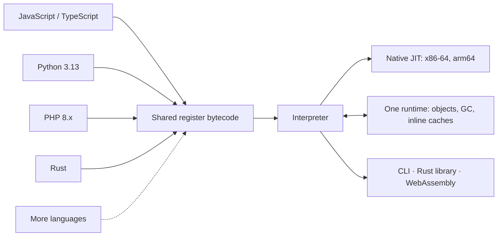

<p align="center">
  
</p>

<h1 align="center">ZIPP</h1>

<p align="center">
  <strong>Zippy Interpreter for Polyglot Programming</strong><br>
  A portable polyglot runtime: one fast virtual machine for JavaScript, TypeScript, Python, PHP 8.x and Rust.
</p>

<p align="center">
  <a href="https://www.zipp.org/">Website</a> ·
  <a href="https://www.zipp.org/playground/">Playground</a> ·
  <a href="#get-zipp">Download</a> ·
  <a href="#embed-it-in-a-web-page-or-nodejs">Embed</a> ·
  <a href="docs/README.md">Docs</a> ·
  <a href="https://www.zipp.org/journal/">Journal</a>
</p>

---

**ZIPP compiles every language it supports into one shared bytecode and runs it
on one virtual machine, written in Rust.** JavaScript, TypeScript, Python, PHP 8.x
and Rust programs run on the same engine, with the same sandbox, the same limits and the
same embedding API, wherever that engine goes: a native command line on
Windows and Linux, a Rust library, or WebAssembly in browsers, Node.js, Deno
and Bun.

**Languages today: JavaScript (with TypeScript and JSX), Python 3.13, PHP 8.x and Rust.**

- **JavaScript** is complete and modern: ES2025, passing **99.999% of test262**: 96,563 / 96,564 executions of the official conformance suite,
  unmodified (pinned to `2e58f87d83`).
- **TypeScript and TSX** run as they are: the JavaScript parser reads the
  types and drops them, and lowers `enum`, `namespace`, parameter
  properties and JSX as tsc emits them, with no transpile step.
- **Python 3.13** compiles straight to ZIPP bytecode (no CPython inside), with
  `async`/`await`, `except*`, PEP 695 type parameters, 23 Apache-2.0 stdlib
  modules added in v0.0.38 (`html.parser`, `urllib`, `datetime`, `tomllib`,
  `unittest`, `logging`, `zlib`/`ZIP_DEFLATED`, etc.), raw byte-for-byte CLI
  stdout/stderr streaming past 64 KiB, native x86-64 JIT fast paths (`0.62×`
  CPython geomean on `tools/python_bench.py`), unmodified
  `html2text`/`markdownify`/`beautifulsoup4`/`PyYAML` support, and a bundled
  `torch` subset for tensors, autograd and training.
- **PHP 8.x** compiles directly into ZIPP bytecode with dual-mode HTML
  templates, CoW arrays, OOP/traits/enums/attributes/Reflection, Composer PSR-4
  autoloading (verified across Laravel 11, Slim 4 and CakePHP 5), selective
  x86-64 JIT + disk OPcache, built-in HTTP/1.1 SAPI & Worker Mode, and a
  browser WebAssembly module (`PhpApp` + `PDO`/`mysqli` over host SQL bridges)
  ([PHP on ZIPP](docs/PHP.md)).
- **Rust** runs scripts, multi-file Cargo projects, `#[test]` suites, and
  HTTP/1.1 Axum/SQLx backend servers directly on the ZIPP VM and native JIT
  with zero external `rustc`/`cargo` invocation, plus a browser WebAssembly
  module ([Rust on ZIPP](docs/RUST.md)).

The virtual machine is built to take more languages: each one is a frontend
that compiles to the shared bytecode and inherits everything below it
([how a language plugs in](docs/LANGUAGES.md)).

## Why ZIPP

| | |
| --- | --- |
| **One VM, many languages** | JavaScript, TypeScript, Python, PHP 8.x and Rust share one runtime, one object model and one garbage collector. Write the part that suits each language in that language. |
| **Fast** | A register VM with inline caches and, on x86-64, a native JIT. In its canonical **v0.0.40** capture (`0cd3eab8`, 24 November 2026) ZIPP runs all 30 benchmark rows in **0.583× Node's time** (**29/30** wins; Normal 13 **0.532×**, Hostile 17 **0.624×**), starts in **11.1 ms**, runs Python at **0.626× CPython 3.13** (26/36 wins), and as a pure interpreter takes **0.430×** Bellard's QuickJS (30/30). [Performance](docs/PERFORMANCE.md) |
| **Correct** | 99.999% of the pinned test262 corpus, unmodified; the one failure is a documented upstream expectation. [Correctness](docs/CORRECTNESS.md) |
| **Sandboxed by default** | Embedded programs reach nothing you have not allowed: no storage, files, network or host functions until you grant each one, with step and time limits. Powers multi-VM browser app containers like [SoftN](https://softn.com) and [FormLogic](https://formlogic.com) ([live container demo](https://www.zipp.org/container-demo/)). |
| **Portable** | Windows (x86-64), Linux (x86-64, arm64, armv7), and WebAssembly for every browser and server runtime. One `.wasm` file per engine. |

## Get ZIPP

Every [release](https://github.com/f2i-com/zipp.org/releases) publishes plain
files, checksummed in its `SHA256SUMS`:

| File | What it is |
| --- | --- |
| `zipp-0.0.40-windows-x86_64-portable.exe` | Windows command line. Run it from anywhere. |
| `zipp-0.0.40-windows-x86_64-installer.msi` | The same, installed for your user and added to `PATH` (no administrator rights needed). |
| `zipp-0.0.40-linux-x86_64`, `-linux-arm64`, `-linux-armv7` | Linux command line for x86-64, 64-bit Arm and 32-bit Arm (hard float), built against glibc 2.35. |
| `zipp-0.0.40-javascript.wasm` | The JavaScript engine for browsers and server runtimes. |
| `zipp-0.0.40-javascript-typescript.wasm` | The same with TypeScript and TSX. |
| `zipp-0.0.40-javascript-lite.wasm` | The same without `Intl` and `Temporal`, built for size. |
| `zipp-0.0.40-javascript-python.wasm` | JavaScript and Python, with torch built in. |
| `zipp-0.0.40-javascript-python-base.wasm` + `zipp-0.0.40-torch-package.wasm` | JavaScript and Python, with torch as a separate add-on. |
| `zipp-0.0.40-javascript-php.wasm` | JavaScript and PHP 8.x, with `PhpApp` SAPI and SQL bridge support. |
| `zipp-0.0.40-javascript-rust.wasm` | JavaScript and Rust, with Axum/SQLx worker-boot support. |
| `zipp-0.0.40-<engine>.wasm.br` | Each of those `.wasm` files compressed with Brotli: about a quarter of the size. Serve it with `Content-Encoding: br` (the browser decodes it); the plain `.wasm` is the default. |
| `zipp-0.0.40-wasm-embed-kit.zip` | `zipp.mjs`, the one file that loads and sandboxes any of the `.wasm` engines, with types, examples and docs. |

**Windows** (PowerShell):

```powershell
$version = '0.0.40'
Invoke-WebRequest "https://github.com/f2i-com/zipp.org/releases/download/v$version/zipp-$version-windows-x86_64-portable.exe" -OutFile zipp.exe
.\zipp.exe js .\app.js
```

Or download and open `zipp-0.0.40-windows-x86_64-installer.msi`, then use
`zipp` in a new terminal.

**Linux**:

```sh
version=0.0.40
arch=x86_64   # or arm64, armv7
curl -fL -o zipp "https://github.com/f2i-com/zipp.org/releases/download/v$version/zipp-$version-linux-$arch"
chmod +x zipp
./zipp js app.js
```

## Run programs

```sh
zipp js app.js                                     # a JavaScript script
zipp mjs app.mjs                                   # a JavaScript module (import/export, top-level await)
zipp app.ts                                        # TypeScript, or app.tsx / app.jsx
zipp py main.py                                    # a Python 3.13 program, with the files beside it as its project
zipp php app.php                                   # a PHP 8.x script or template
zipp php --worker -S 127.0.0.1:8000 -t . index.php # built-in PHP HTTP/1.1 Worker Mode server
zipp rs examples/rust/issue_tracker                # a Rust script or Cargo project directory
zipp rs --serve 127.0.0.1:8080 ./app               # built-in Rust Axum/HTTP worker server (add --watch for live reload)
zipp --help
```

`zipp app.js` (and `.mjs`, `.ts`, `.tsx`) runs a program the way `node`
does: with Node's globals, npm packages from `node_modules`, CommonJS and
the core modules most packages reach for ([what is there](docs/NODE.md));
`ZIPP_NO_NODE=1` gives the plain ECMAScript environment. `WebAssembly` is
there too, compiled to machine code by Wasmtime in the 64-bit command lines.

The native command line uses its JIT on x86-64 and runs the program as
trusted code. To run code you do not trust natively, build the separate
hardened runner, [`zipp-sandbox`](crates/zipp-sandbox/README.md): no JIT, no
`unsafe` code, and enforced instruction, heap, output and wall-clock limits.

## Embed it in a web page or Node.js

You need two files from the [release](https://github.com/f2i-com/zipp.org/releases/tag/v0.0.40):

1. **One engine `.wasm`.** Pick the smallest that runs your language:

   | You need | Download |
   | --- | --- |
   | JavaScript, smallest (no `Intl`, no `Temporal`) | `zipp-0.0.40-javascript-lite.wasm` |
   | JavaScript, complete | `zipp-0.0.40-javascript.wasm` |
   | JavaScript and TypeScript | `zipp-0.0.40-javascript-typescript.wasm` |
   | JavaScript and Python | `zipp-0.0.40-javascript-python-base.wasm` |
   | JavaScript and Python with torch | `zipp-0.0.40-javascript-python.wasm`, or the `-base` engine plus `zipp-0.0.40-torch-package.wasm` when only some pages need torch |
   | JavaScript and PHP 8.x | `zipp-0.0.40-javascript-php.wasm` |
   | JavaScript and Rust | `zipp-0.0.40-javascript-rust.wasm` |

2. **`zipp.mjs`**, the loader, from
   [`zipp-0.0.40-wasm-embed-kit.zip`](https://github.com/f2i-com/zipp.org/releases/download/v0.0.40/zipp-0.0.40-wasm-embed-kit.zip).
   It loads any of the engines.

Put both next to your page, serve the folder over HTTP (`python -m http.server`
or `npx serve`; a page opened as `file://` cannot load modules), and start
with nothing allowed:

```js
import { loadZipp } from "./zipp.mjs";

const zipp = await loadZipp("./zipp-0.0.40-javascript.wasm");
const sandbox = await zipp.createSandbox();       // nothing is permitted
try {
  const { output } = await sandbox.run('console.log("Hello from ZIPP")');
  console.log(output);                            // ["Hello from ZIPP"]
} finally {
  await sandbox.close();
}
```

For Python, load a `-python` engine and pass `{ language: "python" }` to
`createSandbox`. For full-stack PHP 8.x or Rust backends in the browser, load
`zipp-0.0.40-javascript-php.wasm` (`PhpApp` SAPI + `PDO`/`mysqli`) or
`zipp-0.0.40-javascript-rust.wasm` (Axum/SQLx worker-boot) and attach host
capabilities through composable `addAppBridge(namespace, bridge)` plugins (for
example XDB SQLite), sharing the guest VM's instruction budget without expanding
the audited 51-function WASM import surface. Then grant only what the program
needs, one permission at a time:

```js
const sandbox = await zipp.createSandbox({
  limits: { instructions: 50_000_000, timeoutMs: 5000 },
  permissions: { network: ["https://api.example.com/"] },   // fetch() may reach this origin only
});
```

**What a sandbox does.**

- **Each sandbox is one program in its own engine and its own Worker** (a
  worker thread in Node). The program cannot see your page, its DOM,
  `localStorage` or cookies, or Node's `process`, `require` and file system.
- **Everything outside it is denied until you grant it.** JavaScript
  programs can be given private storage (`storage`), a map of files
  (`files`), `fetch` to listed URLs (`network`) and functions you choose
  (`host`). Python programs, in this release, can be given only `files`,
  which become their importable modules.
- **Three kinds of limit, enforced in different places.** The step budget
  (`limits.instructions`, 50 million by default) is counted inside the engine
  and stops runaway computation anywhere. The time limit (`limits.timeoutMs`,
  30 seconds by default) is enforced from outside by ending the Worker, so it
  needs the default isolation: with `isolate: false` the program runs on your
  thread, and only the step budget can stop a loop. Memory, string, output
  and nesting ceilings are fixed in the engine (`zipp.profile.limits` lists
  them).
- **Network access is an allowlist.** List origins
  (`"https://api.example.com"`) or URL prefixes
  (`"https://example.com/data/"`); `network: true` allows any http(s) URL.
  Either way, requests carry no cookies or credentials, the Fetch standard's
  forbidden headers are dropped, a redirect fails unless you allow redirects
  (and then only to listed URLs), and each request has a time and size limit.
- **`zipp.run(code)` is not a sandbox.** It runs the program on the calling
  thread with nothing permitted and the default step budget, but with no
  Worker and no time limit: use it for trusted code and quick checks, and
  `createSandbox()` for anything else.

This is layered protection, not a guarantee: WebAssembly's memory isolation,
an engine built without `unsafe` code or a JIT, default-deny capabilities, a
Worker per program, and limits. Keep your page's Content-Security-Policy (the
loader needs `script-src 'self' blob: 'wasm-unsafe-eval'` and
`worker-src 'self' blob:`), and read [SECURITY.md](SECURITY.md) for the
threat model. The [embed kit guide](crates/zipp-wasm/embed-kit/README.md) has
every option, the [WebAssembly engine reference](crates/zipp-wasm/README.md)
the engine's full API, and [embedding](docs/REFERENCE.md#embedding) the Rust
API.
## Python, torch and the GPU

The Python frontend runs folders of modules, a bundled `torch` subset (eager
CPU tensors, autograd, training) and, experimentally, `torch.compile` onto the
browser's WebGPU or WebGL2, WebAssembly SIMD kernels, or a native GPU through
wgpu. Try it in the [playground](https://www.zipp.org/playground/); the
[GPU guide](docs/GPU.md), [running Python](docs/python/RUNNING.md),
[Python frontend](docs/python/FRONTEND.md) and
[torch compatibility](docs/python/TORCH_COMPATIBILITY.md) pages have the
detail.

## Performance

Ratios are ZIPP's time over the other engine's, so lower is faster. Every
measurement below requires byte-identical output against the reference runtime.

### Canonical PGO capture (v0.0.40, `0cd3eab8`, 24 November 2026)

From the provenance-stamped 15-repetition canonical PGO capture (`publishable:true`,
`ALL_CORRECT=1`, every engine with its production JIT):

| JIT against JIT | ZIPP / Node | ZIPP / Bun | ZIPP / Deno |
| --- | ---: | ---: | ---: |
| All 30 rows (equal-row weight) | **0.583×** | **0.461×** | **0.389×** |
| 13 everyday rows (JSON, regex, maps, classes, promises, parsing...) | **0.532×** (13/13) | **0.457×** | **0.445×** |
| 17 hostile stress rows | **0.624×** (16/17) | **0.464×** | **0.351×** |

ZIPP wins **29 of 30** rows against Node: all 13 everyday rows and **16 of 17**
hostile ones (only `allocation-survival` at `1.141×` remains above 1×). Median process launch:
**11.1 ms** vs. Node 36.3 ms, Bun 55.6 ms, Deno 92.3 ms.
Node v24.19.0 · Bun 1.3.14 · Deno 2.6.10 · ZIPP 0.0.40 canonical PGO.

Measured the same day on `0cd3eab8`:

| Comparison | Ratio |
| --- | ---: |
| Interpreter against interpreter: ZIPP with no native code (`ZIPP_NOJIT=1 ZIPP_NO_RX_JIT=1`) / Bellard's QuickJS (2026-06-04), 30 rows | **0.430×** (30/30) |
| ZIPP's interpreter / QuickJS-NG (0.18.0), 30 rows | **0.330×** (30/30) |
| ZIPP's interpreter / Bun no-JIT · Deno jitless · Node jitless, 30 rows | **0.500×** · **0.652×** · **0.706×** |
| ZIPP Python / CPython 3.13.14, 36 programs, in-process work time (26/36 wins) | **0.626×** (0.601× micro, 0.456× wall) |
| Published `zipp-0.0.40-windows-x86_64-portable.exe` / Node, 13 everyday rows (canonical PGO A/B: 0.997×) | **0.533×** |

### Real-world apps & extra suites in v0.0.40

| Workload | Speedup vs. v0.0.39 | Honest vs. Reference |
| --- | ---: | --- |
| Unmodified JS DOM apps (`linkedom`, `defuddle`, `webforai`) | **1.05×–1.55×** | 8-run wall **1.38×–2.76×** Node (warm loops 4.7×–6.1× V8 TurboFan) |
| Unmodified Python HTML apps (`html2text`, `bs4_css`, `markdownify`) | **1.71×–2.88×** | 8-run wall **1.37×–2.84×** CPython (warm loops 2.6×–7.2× CPython C parsers) |
| JS `bench/regex` (16 patterns) | **1.28×** (`2.44× → 1.90×`) | `literal-utf16` `4.0× → 0.82×` Node |
| PHP & Rust O(N²) fixes | **8.6×–180×** | PHP `array_pop` ~65×, PHP cursor loop ~180×, Rust collections 8.6× |

The full tables, confidence intervals and the remaining gaps are in
[Performance](docs/PERFORMANCE.md) and on [zipp.org](https://www.zipp.org/benchmarks/).

## How it is built



| Path | What it holds |
| --- | --- |
| [`crates/zipp-vm`](crates/zipp-vm) | The VM: parser, compiler, bytecode, interpreter, GC, JITs, and the languages under `src/lang/`. |
| [`crates/zipp-cli`](crates/zipp-cli) | The `zipp` command line. |
| [`crates/zipp-wasm`](crates/zipp-wasm/README.md) | The WebAssembly engines and the [embed kit](crates/zipp-wasm/embed-kit/README.md). |
| [`crates/zipp-sandbox`](crates/zipp-sandbox/README.md) | The hardened native runner for untrusted code. |
| [`crates/zipp-gpu`](crates/zipp-gpu) | Native GPU execution for Python graphs. |
| [`crates/regress-fork`](crates/regress-fork) | The regular-expression engine. |

[How ZIPP works](docs/ARCHITECTURE.md) follows a program from source to
machine code.

## Build from source

```sh
git clone https://github.com/f2i-com/zipp.org.git zipp
cd zipp
cargo build --locked --release
./target/release/zipp js app.js
```

You need stable Rust (releases build with 1.92) and a C toolchain (the MSVC Build
Tools on Windows). [Development](docs/DEVELOPMENT.md) covers the tests,
benchmarks and the WebAssembly build; `crates/zipp-wasm/embed-kit/build-release.sh`
builds every WebAssembly release file locally.

## Documentation

| | |
| --- | --- |
| [Docs index](docs/README.md) | Everything, in one list |
| [Reference](docs/REFERENCE.md) | Architecture, language support, embedding, the CLI |
| [PHP on ZIPP](docs/PHP.md) | PHP 8.x frontend, Laravel/Slim/CakePHP parity, HTTP SAPI & Worker Mode |
| [Rust on ZIPP](docs/RUST.md) | Rust frontend, Cargo projects, `#[test]` runner, Axum/SQLx worker server |
| [Execution profiles](docs/PROFILES.md) | Which build to use for trusted and untrusted code |
| [Security](SECURITY.md) | The threat model and how to report a problem |
| [Release notes](docs/releases/) | What changed in each version |
| [Archive](docs/archive/README.md) | History, including the [previous README](docs/archive/README-through-0.0.25.md) |

## Contributing

Bug reports with a small example, the expected output and your ZIPP version
are the most useful contribution. Browse the
[issues](https://github.com/f2i-com/zipp.org/issues) or the
[performance roadmap](docs/PERF_ROADMAP.md), and see
[Development](docs/DEVELOPMENT.md) before changing the engine: keep output
exact, measure every optimization, and report what did not work too.

## License

[Apache-2.0](LICENSE-APACHE).
