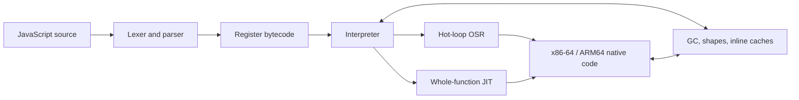

# How ZIPP works

## Python and JavaScript inside one VM

Build with `python-js-interop` for trusted mixed-language projects:

```python
import javascript
print(javascript.eval("[1, 2, 3].map(x => x * 2)"))  # [2, 4, 6]
```

This uses Zipp's own JavaScript evaluator in the **same VM instance**, with copied
lists, dictionaries and scalar results. `from js import eval` is also available.
It is opt-in because JavaScript shares VM globals with the Python runtime.
There are no live cross-language object proxies or JavaScript `.py` imports yet.
See the [build instructions and contract](LANGUAGE_INTEROP.md).

## How it works

Follow a program from source text to running code. Zipp's lexer, parser,
bytecode compiler, NaN-boxed register VM, garbage collector, inline caches and
native JITs are implemented here, so you can explore each stage in one codebase.



x86-64 has the mature function, OSR, helper, inline-cache, integer, double, and
guarded reducer tiers. ARM64 has a smaller guarded whole-function integer
baseline. wasm32 and unsupported native targets use the pure interpreter.

Workspace map:

| Path | Purpose |
|---|---|
| [`crates/zipp-vm`](../crates/zipp-vm) | Parser, compiler, VM, runtime, GC, JITs, and the languages (`src/lang/`: JavaScript and the experimental Python). |
| [`crates/zipp-cli`](../crates/zipp-cli) | `zipp js` / `zipp mjs` / `zipp py` command line. |
| [`crates/regress-fork`](../crates/regress-fork) | ECMAScript regex engine fork and conformance fixes. |
| [`crates/zipp-wasm`](../crates/zipp-wasm/README.md) | Browser/Worker embedding. |
| [`zipp-pyparse`](../crates/zipp-vm/src/lang/python/parser) (in `zipp-vm/src/lang/python/parser`) | Zipp's own Python 3.13 lexer, arena syntax tree and parser, read directly by the Python compiler. |
| [`crates/zipp-gpu`](../crates/zipp-gpu) | Native GPU for `zipp py`: gpu-lab's runtime over wgpu (Vulkan, Direct3D 12, Metal). |
| [`crates/zipp-sandbox`](../crates/zipp-sandbox/README.md) | Separately resolved hardened native runner. |
