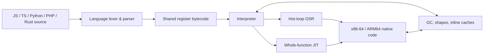

# How ZIPP works

## Python and JavaScript inside one VM

Build with `python-js-interop` for trusted mixed-language projects:

```python
import javascript
print(javascript.eval("[1, 2, 3].map(x => x * 2)"))  # [2, 4, 6]
```

This uses Zipp's own JavaScript evaluator in the **same VM instance**, with copied
lists, dictionaries and scalar results. `from js import eval` is also available.
It is opt-in because JavaScript shares VM globals with the Python runtime.
There are no live cross-language object proxies or JavaScript `.py` imports yet.
See the [build instructions and contract](LANGUAGE_INTEROP.md).

## How it works

Follow a program from source text to running code. Zipp's lexers and parsers
(for JavaScript/TypeScript, Python 3.13, PHP 8.x, and Rust), bytecode compilers,
NaN-boxed register VM, garbage collector, inline caches and native JITs are
implemented here, so you can explore each stage in one codebase.



x86-64 has the mature function, OSR, helper, inline-cache, integer, double, and
guarded reducer tiers (plus `ZIPP_PERF_MAP=1` Linux perf-map output with
sanitized JS function labels as of v0.0.40). ARM64 has a smaller guarded
whole-function integer baseline. wasm32 and unsupported native targets use the
pure-safe interpreter (`safe-sandbox`, zero `unsafe`, metered ICs and
superinstructions).

Workspace map:

| Path | Purpose |
|---|---|
| [`crates/zipp-vm`](../crates/zipp-vm) | Core VM, compiler, runtime, GC, JITs, and all five language frontends under `src/lang/` (`js`, `ts`, `python`, `php`, `rust`). |
| [`crates/zipp-cli`](../crates/zipp-cli) | `zipp js` / `zipp mjs` / `zipp py` / `zipp php` / `zipp rs` command line and HTTP worker servers. |
| [`crates/regress-fork`](../crates/regress-fork) | ECMAScript regex engine fork, UTF-16 prefiltering, and conformance fixes. |
| [`crates/zipp-wasm`](../crates/zipp-wasm/README.md) | Browser/Worker WebAssembly engines (`javascript`, `lite`, `typescript`, `python`, `php`, `rust`), `addAppBridge` plugins, and embed kit. |
| [`zipp-pyparse`](../crates/zipp-vm/src/lang/python/parser) | Zipp's zero-unsafe Python 3.13 lexer, arena syntax tree, and parser. |
| [`zipp-phpparse`](../crates/zipp-vm/src/lang/php/parser) | Zipp's zero-unsafe dual-mode HTML + PHP 8.x lexer and parser. |
| [`zipp-rsparse`](../crates/zipp-vm/src/lang/rust/parser) | Zipp's zero-unsafe Rust 2021/2024 lexer, AST, and parser. |
| [`crates/zipp-gpu`](../crates/zipp-gpu) | Native GPU for `zipp py`: gpu-lab's runtime over wgpu (Vulkan, Direct3D 12, Metal). |
| [`crates/zipp-sandbox`](../crates/zipp-sandbox/README.md) | Separately resolved hardened native runner (`#![forbid(unsafe_code)]`, no JIT). |
