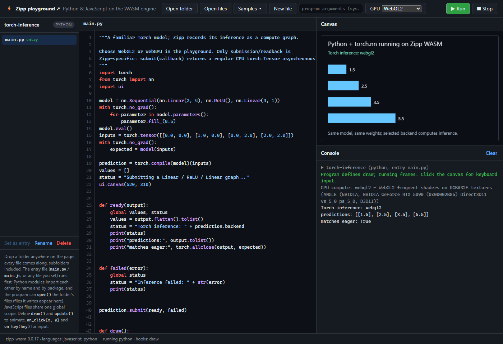
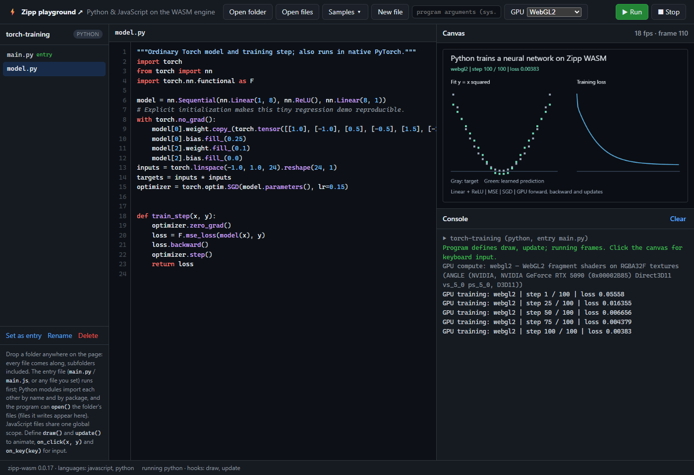

# GPU compute from Python and JavaScript

## What runs where

| What you want to do | Where your code runs | Where the numerical or drawing work runs |
|---|---|---|
| Run JavaScript scripts or embed Zipp | Native Rust VM/JIT, or Zipp's WebAssembly build | CPU; host APIs are supplied by the embedding application |
| Run Python projects in Zipp | Experimental Python frontend on the same VM | CPU, including the bundled `torch` subset |
| Compile a supported Torch model or submit a `zipp_gpu` graph with `zipp py` | Python in the native engine; gpu-lab's runtime in a second engine state | A hardware GPU through wgpu (Vulkan, Direct3D 12, Metal), synchronously; the CPU evaluator when there is none |
| Compile a supported Torch model or submit a Python `zipp_gpu` graph from the playground | Python in the WASM Worker; JavaScript handles the graph | WebGPU compute shaders or WebGL2 fragment shaders; visible CPU fallback in `auto` mode |
| Use GPU graphs from browser JavaScript | An ordinary browser ES module or Worker | The same GPU runtime, without requiring Python or the Zipp VM |
| Run a local language model from a GGUF file (experimental, source only) | A model plugin's Python in the WASM engine; JavaScript reads and binds the checkpoint | The same GPU runtime, with the weights kept as the file's quantized blocks |
| Draw a custom browser visualization | Browser JavaScript with a canvas | WebGL/WebGL2 through the browser-selected adapter |

**GPU support does not automatically move all Python or JavaScript onto a GPU.**
The graph API executes its supported operations on the selected backend.
The playground's `ui` drawing API uses a 2D canvas; the Life computation runs
on the selected graph backend.

## Familiar Torch code, browser GPU execution

```python
import torch
from torch import nn

model = nn.Sequential(nn.Linear(2, 4), nn.ReLU(), nn.Linear(4, 1))
x = torch.tensor([[1.0, 2.0], [3.0, 4.0]])

inference = torch.compile(model)(x)  # no zipp_gpu import or backend name
inference.submit(lambda y: print(y.tolist()))
```

Your model, tensor creation and forward pass use the supported Torch API.
Zipp records the inference graph and the host executes it on the selected
backend. **`submit(callback)` is a Zipp extension:** browser GPU completion is
asynchronous; this is not a drop-in implementation of PyTorch's `torch.compile`.
It supports float32 inference and an opt-in dense-model GPU training path; it does not run CUDA scripts.
The callback receives a regular CPU Torch-compatible tensor. Eager CPU
`nn.Conv2d` also supports forward/backward passes and optimizer updates;
GPU convolution remains future work.

Try **Samples → Python: Torch ML inference (GPU)** in the playground. The
[complete example](../examples/python/torch_gpu/main.py) draws its predictions and
checks them against eager inference with the same weights. Explicit GPU selection
fails visibly if unavailable; automatic selection reports the backend it used.

[](../examples/python/torch_gpu/main.py)

## Train a small model on the browser GPU

The ordinary training step stays familiar:

```python
import torch.nn.functional as F

optimizer = torch.optim.SGD(model.parameters(), lr=0.01)
target = torch.tensor([[1.0], [2.0]])

def train_step(x, target):
    optimizer.zero_grad()
    loss = F.mse_loss(model(x), target)
    loss.backward()
    optimizer.step()
    return loss

compiled_step = torch.compile(train_step, training=True)
compiled_step(x, target).submit(lambda loss: print(loss.item()))
```

**`training=True` and `.submit(...)` are experimental Zipp extensions**, not
PyTorch's synchronous `torch.compile` API. Forward computation, first-order
gradients and SGD updates execute on the selected backend. The success callback
receives the loss after the CPU model's weights and gradients have been updated.
Wait for that callback before recording the next step.

Try **Samples → Python: Torch ML training (GPU)** to watch a small network learn
`y = x²`, with predictions and a live loss curve. Its
[model and training step](../examples/python/torch_training/model.py) also run in
native PyTorch; the [playground driver](../examples/python/torch_training/main.py)
provides asynchronous scheduling and graphics.

[](../examples/python/torch_training/model.py)

What `torch.compile` captures today is float32 dense layers with `relu`, `gelu`,
`sigmoid` or `tanh`, `softmax`/`log_softmax` over the last dimension, `sum`/`mean`
over all elements or one dimension, MSE-style losses and `F.cross_entropy`
against integer class targets (the protocol's fused operation), trained with
SGD (momentum, dampening, Nesterov, weight decay), Adam or AdamW. Momentum
buffers and Adam moments are read from `optimizer.state`, updated in the graph
and written back with the weights, so the next step continues where this one
left off.
**Each call captures a new graph, uploads inputs and weights, and reads back the
loss, gradients and updated weights.** To keep them on the device, prepare the
step once from an example call and then feed only each step's batch:

```python
prepared = compiled_step.prepare(x, target)          # records once; weights and
prepared.step(lambda loss: print(loss.item()), x, target)   # optimizer state stay resident
prepared.steps(lambda losses: print(len(losses)), [(x, target)] * 8)  # 8 steps, one submission
prepared.sync(lambda p: print("model and optimizer.state are current"))
prepared.dispose()
```

`prepare`, `step`, `steps`, `sync` and `dispose` are Zipp extensions too. While a
prepared session is live its parameters are refused to compiled calls and eager
`optimizer.step()`; `sync()` leaves the model and `optimizer.state` exactly
where the same number of eager steps would (checked against PyTorch 2.11 to
about 1e-7). On an RTX 5090 in Chrome, a 784-256-10 batch-64 Adam step driven
from Python costs (warm medians) 74 ms per `compiled()` call on WebGPU, 5.1 ms
per `prepared.step`, and 1.8 ms per step with `prepared.steps` at eight steps
per run (WebGL2: 89 / 3.3 / 2.2 ms; WebAssembly: 74 / 4.9 / 3.6 ms). Small
examples demonstrate correctness, not a GPU speedup over native PyTorch. There is
no graph cache or multi-GPU training. See the
[Torch compatibility guide](python/TORCH_COMPATIBILITY.md) for supported operations,
limits and failure behavior. NCA experiments remain in their separate repository.

## Start the local GPU lab

The landing page embeds the complete project playground and exposes it at
**[`/playground`](https://zipp.org/playground/)**. It supports folders, loose files,
Python/JavaScript samples, entry files, arguments, editing, console/canvas output
and GPU selection. Files stay in the browser's virtual filesystem.

For a local source checkout:

```sh
cd crates/zipp-wasm
./build-variants.sh all
node playground/serve.cjs
```

Open the printed playground URL, choose **Samples → Python: Game of Life**, select
WebGL2 or WebGPU, and press Run. The console identifies the actual backend.
`auto` visibly falls back to CPU/WASM when hardware is unavailable; explicit GPU
selection reports an error instead. Browser settings decide which adapter is used.

The native NCA research project now lives independently at
[neuralautomata.com](https://github.com/f2i-com/neuralautomata.com).
Zipp does not include its PyTorch runner, models, checkpoints or native endpoints.

## GPU computing from JavaScript and Python

**Yes: JavaScript can use WebGL directly.** [WebGL is a browser JavaScript API](https://developer.mozilla.org/en-US/docs/Web/API/WebGL_API),
and this project's [WebGL2 graph backend](../crates/zipp-wasm/gpu-lab/src/backends/webgl2.mjs),
[WebGPU graph backend](../crates/zipp-wasm/gpu-lab/src/backends/webgpu.mjs), and
[CPU reference backend](../crates/zipp-wasm/gpu-lab/src/backends/cpu.mjs) are written in
JavaScript. Python is one way to author work for that runtime.

### Browser JavaScript: run a GPU graph

Save the following as `gpu-example.html` in the repository root, start the local
server above, and open `http://127.0.0.1:8765/gpu-example.html` (using the printed
port). It runs directly in the browser and requires no Python or Zipp build.

```html
<!doctype html>
<meta charset="utf-8">
<title>JavaScript GPU graph</title>
<pre id="output">Running a WebGL2 graph…</pre>
<script type="module">
import { createRuntime } from "/crates/zipp-wasm/gpu-lab/src/runtime.mjs";

const output = document.getElementById("output");
let runtime;
try {
  runtime = await createRuntime({ backend: "webgl2" });
  const result = await runtime.execute({
    version: 1,
    nodes: [
      { id: 0, op: "input", shape: [3], data: [-2, 3, 4] },
      { id: 1, op: "input", shape: [3], data: [10, 20, 30] },
      { id: 2, op: "mul", a: 0, b: 1 },
      { id: 3, op: "relu", a: 2 }
    ],
    outputs: [{ name: "values", id: 3 }]
  });
  output.textContent = JSON.stringify({
    backend: result.backend,
    adapter: runtime.info().adapter,
    values: result.outputs.values.data // [0, 60, 120]
  }, null, 2);
} catch (error) {
  output.textContent = error.message;
} finally {
  runtime?.dispose();
}
</script>
```

Use `backend: "webgpu"` for WGSL compute shaders, or `"auto"` to try WebGPU,
WebGL2, compiled WASM and JavaScript in that order. Explicit GPU selections
fail if unavailable; `auto` reports any initialization fallback through
`runtime.info().fallbackAttempts`. Await each execution before submitting
another to the same runtime. Only named outputs are read back to JavaScript.

For your own graphics, browser JavaScript can create a separate canvas and call
`canvas.getContext("webgl2", { powerPreference: "high-performance" })` to work
with WebGL directly. The graph API supplies a bounded set of float32 operations;
it does not turn arbitrary JavaScript into shaders. The WebGL2 backend shows
how float tensors are uploaded and processed with GLSL.

### Python: author the same graph in the playground

Paste this into a Python entry file in the WASM playground, select WebGL2 or
WebGPU in its toolbar, and press **Run**:

```python
from zipp_gpu import Graph

def show(result):
    print(result["backend"], result["outputs"]["values"]["data"])

g = Graph()
a = g.tensor([-2, 3, 4])
b = g.tensor([10, 20, 30])
g.submit(show, values=(a * b).relu())  # callback receives [0, 60, 120]
```

Python records the graph and submits it through a host request. The Worker's
JavaScript runtime validates it, allocates GPU buffers/textures, runs the shaders,
reads the requested outputs, and delivers the callback between VM calls.
Supported operations include elementwise arithmetic, ReLU, matrix multiplication,
sum and a wrapped Conway-Life update. These are float32 operations, with the
shape/work limits in the [GPU Lab documentation](../crates/zipp-wasm/gpu-lab/README.md).
Running this Python code through the native Zipp CLI runs the same graphs on a
hardware GPU through wgpu (Vulkan, Direct3D 12 or Metal) when one is present,
synchronously, and otherwise on its local CPU reference evaluator (`--no-gpu` or
`ZIPP_GPU=0` forces it). It does not start PyTorch or CUDA.

### Browser JavaScript versus JavaScript inside Zipp

The HTML example runs in the **browser's JavaScript engine**. JavaScript files
loaded into the **Zipp playground editor** run inside the Zipp VM and do not
automatically receive browser `document`, canvas or WebGL objects.

The current playground connects `zipp_gpu` requests for **Python guest programs**.
Its JavaScript guest GPU bridge is **not yet wired into that playground**. For a
custom Zipp embedder, the repository supplies
[`createZippGPUAdapter`](../crates/zipp-wasm/gpu-lab/src/zipp-adapter.mjs) and
[`gpuExecute` / `gpuExecuteAsync`](../crates/zipp-wasm/gpu-lab/src/zipp-guest.js):
the host must install the guest shim, grant `gpu.execute`, drain and dispatch
the host-call queue, and deliver callbacks. The adapter tests cover that contract;
they are not a claim that the stock JavaScript playground exposes it already.
